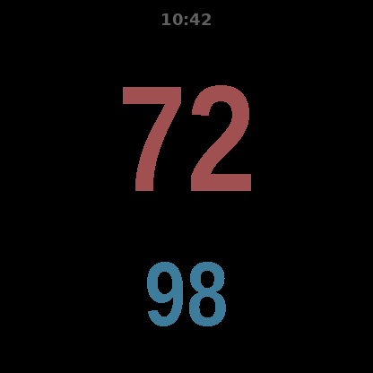

# Big Heart

A Garmin Connect IQ watch face for the **Forerunner 265** that shows heart rate
and SpO2 in the largest normal-font numerals that fit the round 416×416 AMOLED
screen. Heart rate is red, SpO2 is blue, and a small clock sits at the top.


## Features

- **Heart rate** — red, up to 195 px tall (156 px for three-digit values).
- **SpO2** — blue, 104 px tall.
- **Time** — small grey clock at the top, following the watch's 12/24-hour setting.
- No labels: colour identifies the values.
- Keeps working in **Always On Display** with a smaller, dimmed layout.
- Uses the system Pulse Ox complication for current SpO2, with sensor-history
  fallback.
- Reads Garmin sensor history for heart rate, so no activity needs to be
  recording.

The numerals use a normal condensed sans font (Liberation Sans Narrow Bold)
converted to large 1-bit bitmap fonts. This keeps the glyphs crisp without
shipping a giant font atlas.

## Requirements

| Item | Requirement |
| --- | --- |
| Watch | Forerunner 265 (`fr265`) |
| Watch firmware | **29.05 or newer** for sideloading the current build |
| Connect IQ SDK | **9.3.0** (current) |
| Developer key | RSA 4096-bit Connect IQ signing key |
| Cable | Garmin data cable (not charge-only) |

Older Forerunner 265 firmware (for example 17.26) rejects PRGs built with
SDK 9.3.0 with `Signature check failed` in the watch's CIQ log. Update the
watch first, or build with an SDK from the watch's firmware era.

## Build

```bash
./build.sh
```

This produces `bin/BigHeart.prg`. The script uses the SDK selected in
`~/.Garmin/ConnectIQ/current-sdk.cfg` and the developer key at
`~/.Garmin/ConnectIQ/developer_key.der`.

Override them if needed:

```bash
CONNECTIQ_SDK=/path/to/sdk \
CONNECTIQ_KEY=/path/to/developer_key.der \
./build.sh
```

The fonts in `resources/fonts/` are generated and committed. To recreate them
after changing a size:

```bash
python3 tools/make_fonts.py
```

`tools/preview.py` renders the layout to PNG without the simulator.

## Install on the Forerunner 265

The Forerunner 265 exposes its storage over **MTP**, not as a normal USB block
device. It will not appear in `lsblk`.

1. Build the app with `./build.sh`.
2. On the watch, set the USB mode to MTP:
   - **UP → System → USB Mode → MTP**, or
   - **UP → Watch Settings → System → Advanced → USB Mode → MTP**
   - Depending on firmware, the data option may be labelled **Mass Storage**
     instead of MTP. Do not choose **Garmin** mode.
   - If the option is missing, leave the default: the watch normally enters
     MTP automatically when connected to a computer.
3. Connect the watch with the Garmin data cable.
4. On Linux, GNOME/gvfs normally mounts the watch automatically. Then run:

   ```bash
   ./install.sh
   ```

   The installer finds GNOME's MTP mount (and older FAT-style Garmin
   mounts), copies `bin/BigHeart.prg` to `GARMIN/Apps/`, verifies the size, and
   prints the destination.
5. If the watch does not appear, use an MTP client manually:

   ```bash
   sudo apt install simple-mtpfs
   simple-mtpfs --list-devices
   mkdir -p ~/garmin-mtp
   simple-mtpfs ~/garmin-mtp
   find ~/garmin-mtp -type d -iname Apps
   cp bin/BigHeart.prg ~/garmin-mtp/GARMIN/Apps/
   fusermount -u ~/garmin-mtp
   ```

   Some watches nest the path as `~/garmin-mtp/Primary/GARMIN/Apps`.

6. Press **Back** on the watch's connect screen to eject, then unplug.
7. Hold **UP → Watch Face**, scroll to the end, and select **Big Heart**.
   A reboot may be needed on some firmware versions.
8. Accept the **sensor history** permission prompt the first time it runs.

On newer Garmin firmware the installed `.prg` is moved into hidden storage
after installation, so it disappears from `GARMIN/Apps` on the next connection.
That is normal and does not mean the install failed.

To keep the values visible continuously, enable **Always On Display** in the
watch's display settings.

## How the values update

A Connect IQ watch face cannot switch the optical sensors on by itself. It
reads Garmin's recorded sensor history:

- **Heart rate** comes from the watch's normal wrist-HR sampling, typically
  about once a minute.
- **SpO2** is read from the system **Pulse Ox complication**
  (`COMPLICATION_TYPE_PULSE_OX`), which is the same current reading shown by
  the Pulse Ox glance. The face subscribes to complication changes, so it
  updates when a new reading is available.
- If the Pulse Ox complication has no value, the face falls back to the last
  valid sensor-history sample. Garmin's SpO2 history can be oldest-first,
  contain empty entries, and lag behind the live reading.
- SpO2 only appears as often as Pulse Ox is configured to measure it. For
  daytime readings set **Pulse Ox → All Day**; *During Sleep* works while you
  sleep. With Pulse Ox off or manual, SpO2 usually shows `--` or an old value.
- Each value is refreshed on every redraw (wrist raise and at least once per
  minute), not just once a minute.
- When no valid sample exists, the value is shown as `--`.
- After installing or enabling Pulse Ox, the first SpO2 reading can take a few
  minutes to appear.

This is normal for watch faces. For beat-to-beat data you need an activity
profile or a data field while recording an activity, which is a different app
type.

## Exporting HR and SpO2 history

The watch face cannot write files: Connect IQ has no filesystem API. To collect
a long-term history for analysis, use `tools/export_health.py`, which reads
Garmin's own FIT recordings on a computer and writes plain CSV files.

Get the data either from:

- **Garmin Connect**: *Account Settings → Data Management → Export Your Data*.
  Garmin emails a download link; the zip contains `*_WELLNESS.fit` files.
- **The watch over USB/MTP**: copy the `GARMIN/Monitor` folder. Heart rate is
  present there, but Pulse Ox readings may only exist in the Garmin Connect
  export. Run with `--inspect` first to see which messages are available.

Install the dependency and run the exporter:

```bash
python3 -m pip install -r tools/requirements.txt
python3 tools/export_health.py ~/Downloads/garmin_export.zip -o health_export
```

The script merges heart rate from `monitoring` messages (including samples that
only carry a 16-bit timestamp) with SpO2 from `spo2_data` and `hsa_spo2_data`
messages. It sorts and de-duplicates samples and writes one file per **local**
day, named from the day and the first sample:

```text
health_export/HR_SpO2_2026-11-13_170500.csv
```

Each file starts with a header and uses ISO-8601 timestamps:

```csv
timestamp_utc,timestamp_local,hr_bpm,spo2_pct
2026-11-13T22:05:00Z,2026-11-13T17:05:00-05:00,64,96
2026-11-13T22:06:00Z,2026-11-13T17:06:00-05:00,66,
```

Useful options:

- `--inspect` — print the FIT message types and sample counts without writing.
- `--tz Europe/Berlin` — local timestamps and daily rollover in a named zone.
  The default uses this computer's local timezone, including DST rules.
- `--template '{date}-health.csv'` — custom filename; `{date}` and `{time}` are
  replaced. The default is `HR_SpO2_{date}_{time}.csv`.
- `--merge` — merge into CSVs already in the output directory, so repeated
  partial exports accumulate instead of overwriting.

Tests: `python3 -m unittest tools.test_export_health -v` (the end-to-end tests
are skipped when `garmin-fit-sdk` is not installed).

## Always-on (ambient) mode

The Forerunner 265 has an AMOLED panel with Garmin's burn-in protection. An
always-on face must stay dim and must not leave too many pixels lit.

In ambient mode the face keeps the same normal font and layout, but uses
smaller numerals (**120 px HR**, **72 px SpO2**), dimmer colours, and shifts
the readout a few pixels each minute. Normal viewing mode uses the full-size
195 px / 104 px numerals.



Three-digit heart rates use the 156 px font in normal mode so the digits still
fit inside the round display. Three-digit SpO2 values (100%) fit the 104 px
font.

## Project layout

```text
manifest.xml                  Connect IQ app manifest (watchface, fr265)
monkey.jungle                 Build configuration
source/
  BigHeartApp.mc              App entry point
  BigHeartView.mc             Data, layout, full-power and ambient drawing
resources/
  drawables/                  Launcher icon
  fonts/                      Generated BMFont .fnt + .png atlases
  strings/strings.xml         App name
tools/
  make_fonts.py               Regenerates the bitmap fonts
  preview.py                  Renders previews without the simulator
  export_health.py            Exports FIT-based HR/SpO2 history to daily CSV
  requirements.txt            Python dependency for the exporter
docs/                         Preview images used by this README
build.sh                      Builds bin/BigHeart.prg
install.sh                    Copies the build to a mounted watch
```

The fonts are generated at these sizes:

| File | Ink height | Use |
| --- | --- | --- |
| `hr_large` | 195 px | 1–2 digit HR |
| `hr_small` | 156 px | 3 digit HR and `--` |
| `spo2` | 104 px | SpO2 |
| `hr_ambient` | 120 px | HR in ambient mode |
| `spo2_ambient` | 72 px | SpO2 in ambient mode |

## Troubleshooting

**Big Heart is not in the watch-face list**
Reboot the watch and scroll to the end of the list. Check the Connect IQ app on
the watch under *Installed*. If the app is missing there, read
`GARMIN/Apps/LOGS/CIQ_LOG.YML` over MTP.

**`Signature check failed on file: BigHeart`**
The watch firmware is older than the build SDK. Update the watch firmware, or
build with a Connect IQ SDK from the watch's firmware era.

**SpO2 stays `--`**
Check that the Pulse Ox glance on the watch shows a value. If it does, the
complication should provide the same value; the face falls back to sensor
history if the complication is unavailable. If the glance is also empty, enable
**Pulse Ox → All Day** and wear the watch snugly. SpO2 measurements are
periodic, not continuous.

**Watch not detected on Linux**
Check `lsusb | grep -i 091e`:

- `091e:50a1` — MTP mode; GNOME should mount it under
  `/run/user/<uid>/gvfs/mtp:host=...`.
- `091e:0003` — Garmin mode, not MTP; switch USB mode to MTP and reconnect.

Also use a data-capable cable, a direct USB port, and close other MTP clients.

**`cp: Operation not supported` when copying**
GNOME's MTP mount is a FUSE filesystem. Use `gio copy`, which `install.sh`
does, or `simple-mtpfs` instead of plain `cp`.

**SpO2 does not match the glance**
The face subscribes to the system Pulse Ox complication (`ComplicationSubscriber`
permission). If the complication is unavailable, it uses the last valid
sensor-history sample, which can be older than the glance.

**Where is the CIQ log?**
Over MTP: `GARMIN/Apps/LOGS/CIQ_LOG.YML`. It contains the reason an install was
rejected and any runtime crash details.

## Tested configuration

- Garmin Forerunner 265 (`006-B4257-00`)
- Watch firmware 29.05
- Connect IQ SDK 9.3.0
- Linux with GNOME/gvfs MTP

## Font credit

The bitmap fonts are generated from **Liberation Sans Narrow Bold**.

## License

Licensed under the Apache License, Version 2.0.
See [LICENSE.md](LICENSE.md).
